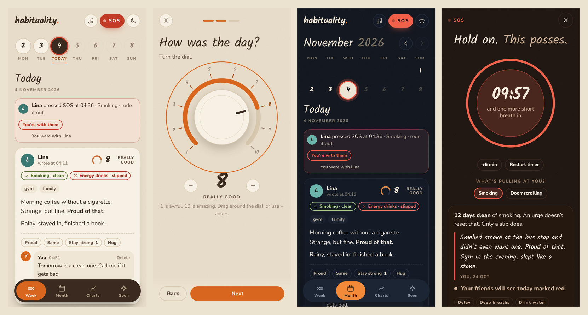

# habituality.

A small, cozy journal for a group of friends who are quitting habits together.
Write your day, turn a dial, see how everyone else is doing, and press **SOS** when it gets hard.



## What it does

- **Week and month views:** tap a day to see everyone's entries, like a comment thread.
- **Write today, see all:** friends' entries stay hidden until you've written your own for today.
- **A daily entry in three steps:**
  1. Clean or slipped, for each habit you follow.
  2. A 1–10 dial for how the day was.
  3. Optional tags, a formatted note and photos.
- **Reactions and replies:** quick reactions, or a reply with text or a photo.
- **SOS button:** logs the urge, flashes the screen and marks the day red for everyone.
  - It starts a 10-minute breathing timer and music.
  - Friends get a live alert and can answer "I'm here".
- **Shared radio:** a playlist everyone can add songs to, with a mini-player above the tab bar.
- **Light and dark mode**, made for phones first.

## How it runs

One page, `index.html`, works in three places:

| Where | Data is stored in | Who can sign in |
|---|---|---|
| Self-hosted with `server.py` | SQLite + a folder for uploads | Accounts created with a one-time setup code or an invite link |
| Opened as a plain file | Nowhere | Nobody: it shows made-up example data |

`server.py` is one Python file that only uses the standard library:
- SQLite stores the data.
- Server-Sent Events push changes live to every open tab.
- Range requests let songs stream and skip.

## Self-hosting

It's built for a Proxmox container that is only reachable through Tailscale, with no open ports.
Full walkthrough: **[docs/SETUP.md](docs/SETUP.md)**

Short version (Debian or Ubuntu, as root):

```sh
apt install -y git python3
git clone https://github.com/slarem1711/habituality.git
cd habituality
sh install.sh                 # prints a one-time setup code
tailscale serve --bg 8080     # private https address inside your tailnet
```

Admin commands: `habituality invite | users | passwd NAME | bans | unban IP | backup`

## Security

- **No public door:** the server only listens on `127.0.0.1`, and Tailscale Serve is the way in. Friends get access by having the machine shared with them.
- **Accounts:** you need either the owner's one-time setup code or an invite link (one use, valid 7 days).
- **Passwords:**
  - Stored as scrypt hashes.
  - At least 12 characters.
  - Checked against about 80,000 common passwords and simple patterns (keyboard rows, number runs, your own name).
- **Blocking:** 10 wrong tries in a row from one address block it until the owner runs `habituality unban`.
- **Server-side checks:**
  - Every change is checked on the server, so you can only edit your own entries.
  - Uploads are type-checked, and SVG files aren't accepted.
  - Every change needs a custom header, which blocks requests forged from other sites (CSRF).
- **Known limit:** "write today, see all" is a rule in the page, not on the server. Basically you cant see other people's entries only after you write your own entry.

## Status

First version. The **Charts** and **Soon** tabs are placeholders.

## Credits
- Designed and architected by me.
- Code generated with the help of [Claude](https://claude.ai) by Anthropic.
- Common-password list from [SecLists](https://github.com/danielmiessler/SecLists), MIT License (see [`licenses/`](licenses/)).
- Fonts: [Kalam](https://fonts.google.com/specimen/Kalam) and [Nunito](https://fonts.google.com/specimen/Nunito), loaded from Google Fonts (SIL Open Font License).

## License

[MIT](LICENSE)
